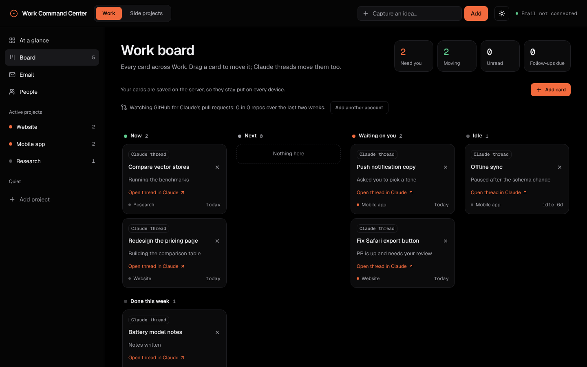

# Command Center

One calm screen for everything your Claude threads are doing.

If you run many Claude projects at once, each with several threads, it's hard to see which ones are working, which are waiting on you, and which have gone quiet. Command Center puts every thread on a board, under the same project it lives in on Claude, with how long it has sat there.



- **Working**, **Up next**, **Waiting on you**, **Idle** (with how many days) and **Done**, for every project.
- **Spaces**, such as your company and your side projects, each with its own projects and colour. One host can show all of them with a switch, or a host can show just one.
- **GitHub watch.** Pull requests that Claude opens (from `claude/` branches) show up as cards by themselves, under the right project. Merged ones move to Done.
- **Email, optional.** Add IMAP mailboxes and see only mail from people, tagged by project. Opening a message never marks it read. You can reply from the dashboard, and it lists the people you wrote to who haven't replied yet.
- **Deadlines, quick capture and server health** for the machine it runs on, plus "is it up" checks for others.

It's a small self-hosted Next.js app. Everything you add stays in one Docker volume on your own server. There is no database and no outside service.

> Command Center is an independent project. It is not made by or affiliated with Anthropic.

## How threads get on the board

Claude has no public API for your projects and threads, so the threads report themselves. You paste a short instruction into each Claude project (see [docs/thread-instructions.md](docs/thread-instructions.md)), and its threads post their card to `/api/report` whenever they start, need you or finish. That address takes a secret key, and it can only add or move a card.

## Set it up

1. **Describe your spaces and projects** in [`command.config.json`](command.config.json). Use exactly the names of your Claude projects.

   ```json
   {
     "spaces": [
       { "id": "work", "title": "Work", "name": "Acme Labs", "accent": "#c2410c", "accentDark": "#f26a3d",
         "projects": ["Website", "Mobile app"], "githubOwners": ["acme-labs"], "hosts": ["work.example.com"] }
     ],
     "repoHome": { "acme-infra": { "space": "work", "project": "Website" } },
     "fallback": { "space": "work", "project": "Website" }
   }
   ```

   | Key | What it does |
   | --- | --- |
   | `projects` | Your Claude project names. Threads and PRs are filed under these. |
   | `githubOwners` | GitHub users or orgs whose repos belong to this space when the repo name matches no project. |
   | `hosts` | Host names that show only this space. Leave empty to show every space everywhere. |
   | `repoHome` | Repos whose name matches no project, and where their PRs go. |
   | `fallback` | Where any other PR goes. |

2. **Make your secrets.** Copy `.env.example` to `.env` and fill it in. `openssl rand -hex 32` makes a good value.
   - `DASHBOARD_PASSWORD` turns on the built-in login. Leave it empty only if your proxy already asks for a login (Authentik, Cloudflare Access, Tailscale and so on).
   - `REPORT_TOKEN` is the key your threads send. It must be at least 32 characters.

3. **Run it.**

   ```bash
   docker compose up -d --build     # listens on 127.0.0.1:3300
   ```

   Put it behind HTTPS with your usual reverse proxy, such as Caddy, nginx or Cloudflare Tunnel. Only `/api/report` needs to be reachable without a login.

4. **Connect your threads** with [docs/thread-instructions.md](docs/thread-instructions.md).

5. **Optional: connect GitHub.** On the Board page, choose *Connect GitHub* and paste a fine-grained token with read-only access to Contents and Pull requests. Use one token per owner. Tokens are kept on the server (mode 600) and are never sent back to the browser.

### Local development

```bash
npm install
npm run dev                      # http://localhost:3000
STATE_STORE=./data/state.json MAIL_STORE=./data/mailboxes.json GITHUB_STORE=./data/github.json npm run dev
```

`command.config.json` is read at build time, so restart or rebuild after you change it.

## Security notes

- Mailbox passwords and GitHub tokens are stored in the data volume with file mode 600 and are never returned to the browser.
- `/api/report` compares the key in constant time. A refused call logs only lengths, never the key.
- Nothing is sent or deleted on your behalf. Email is read-only until you press Send.

## Contributing

Issues are very welcome: bugs, ideas, and how you use it. Pull requests are welcome too. Please open an issue first for anything large, so we can agree on the approach.

## Built with

- [Next.js](https://nextjs.org) (MIT)
- [shadcn/ui](https://ui.shadcn.com) components (MIT), copied into `src/components/ui` and adapted
- [Tailwind CSS](https://tailwindcss.com) (MIT)
- [Radix UI](https://www.radix-ui.com) (MIT), [lucide](https://lucide.dev) icons (ISC), [dnd-kit](https://dndkit.com) (MIT), [next-themes](https://github.com/pacocoursey/next-themes) (MIT)
- [ImapFlow](https://github.com/postalsys/imapflow) (MIT), [mailparser](https://github.com/nodemailer/mailparser) (MIT), [Nodemailer](https://nodemailer.com) (MIT-0)
- [Geist](https://vercel.com/font) fonts (SIL Open Font License)

## Licence

[MIT](LICENSE) © 2026 Amaete Venture Studios
